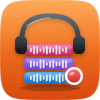
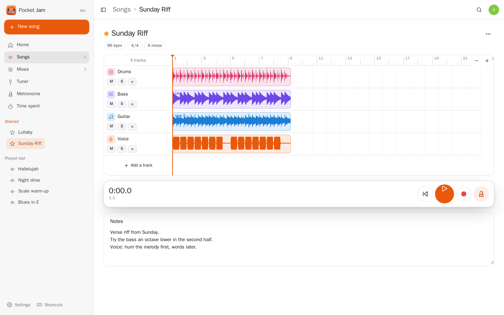
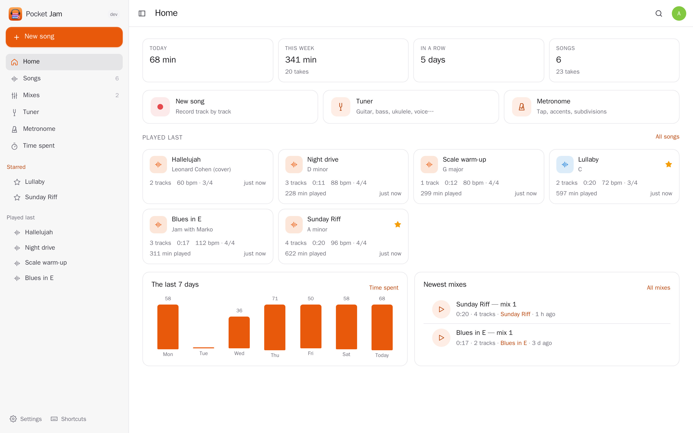
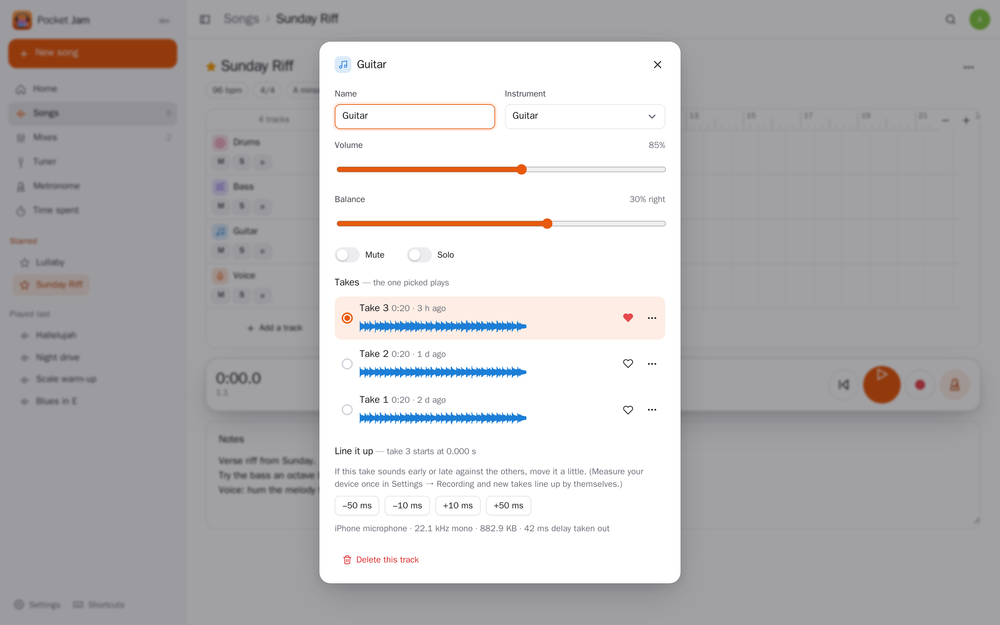
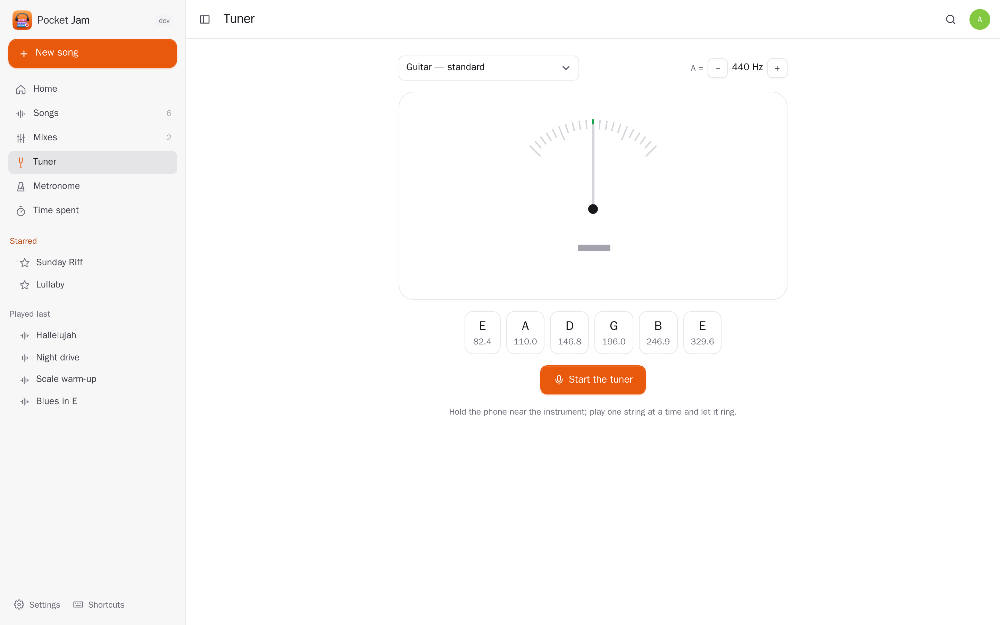
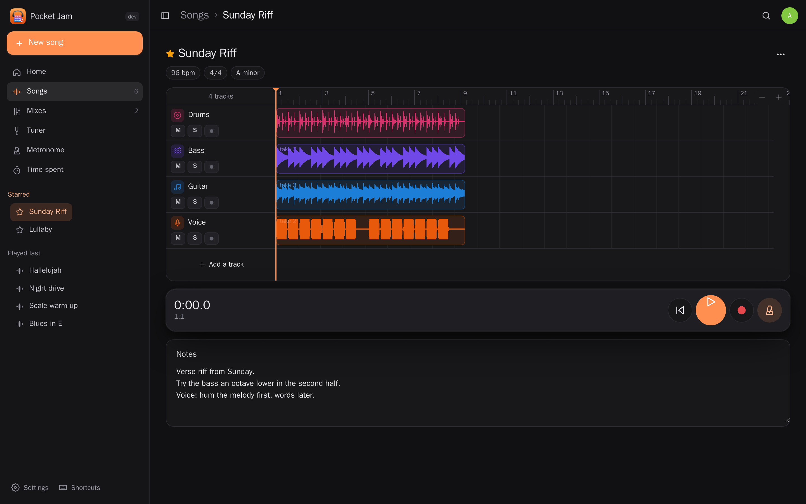
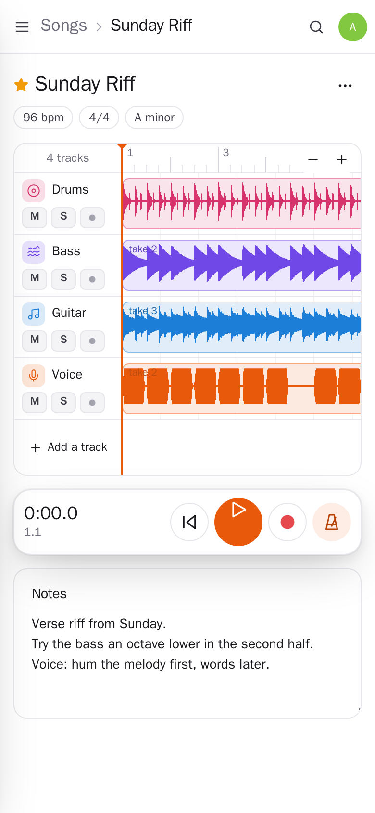
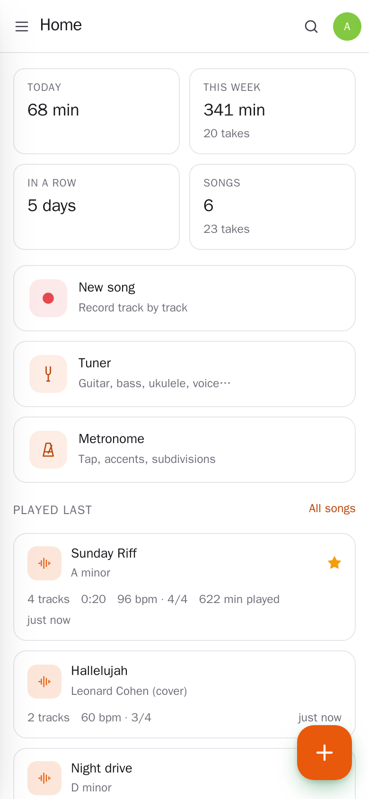
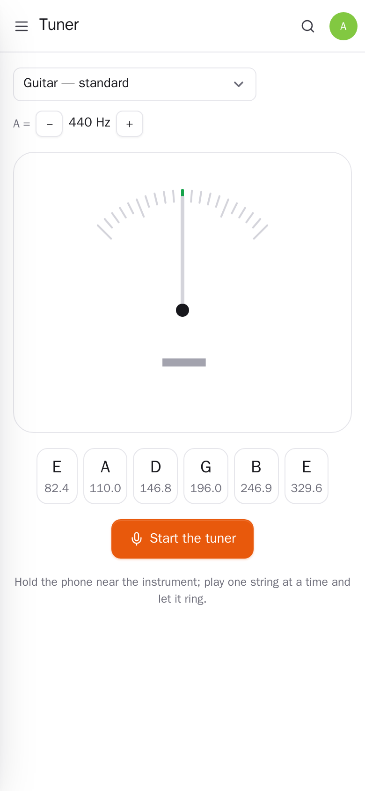
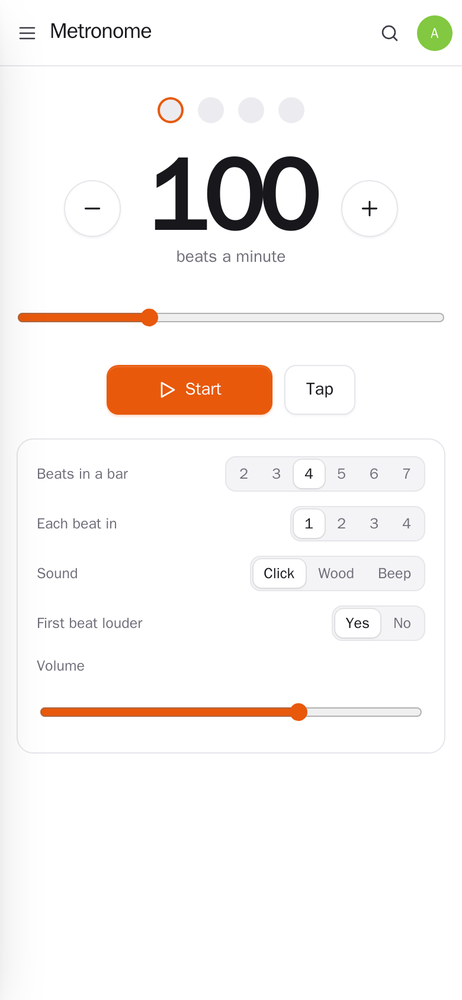

<p align="center"></p>
<h1 align="center">Pocket Jam</h1>
<p align="center">Record music on your phone or computer, one layer at a time: lay down a guitar, then listen to it on headphones while you record the bass, then the voice. A click and a count-in keep you in time, the device’s delay is taken out so everything lines up, every take is kept so you can pick the best one, and each track has its own volume, balance, mute and solo. Mix it down to one file, or take the tracks to another recording app. A tuner and a metronome are built in.<br>One Go binary, one SQLite file, one volume. Part of the Pocket apps; works on its own too.</p>
<p align="center">
  <a href="https://github.com/abjelosevic88/pocket-homelab-jam/actions"></a>
  <a href="https://github.com/abjelosevic88/pocket-homelab-jam/pkgs/container/pocket-homelab-jam"></a>
  <a href="LICENSE"></a>
</p>

---

<p align="center"></p>

<table>
  <tr>
    <td width="50%"></td>
    <td width="50%"></td>
  </tr>
  <tr>
    <td align="center"><sub>Home: time played today and this week, the songs played last, the newest mixes.</sub></td>
    <td align="center"><sub>A track: volume and balance, every take kept (pick the one that plays), nudge a take into place.</sub></td>
  </tr>
  <tr>
    <td width="50%"></td>
    <td width="50%"></td>
  </tr>
  <tr>
    <td align="center"><sub>The tuner: guitar, bass, ukulele, violin family and more, or any note.</sub></td>
    <td align="center"><sub>Dark mode follows your system.</sub></td>
  </tr>
</table>

<p align="center">
  
  
  
  
</p>

## What it does

**Recording, layer by layer**
- A **song** is a set of tracks with a tempo, a time signature and a key. Add a track for each instrument or voice — or bring one in from a file, from **Pocket Files** or from your **Pocket Music** library as a backing track.
- **Record** on the armed track while the others play: a count-in, then the click on every beat (or not), recording from the start of the bar where the playhead is. The browser’s own voice filters are off (no noise suppression, no echo cancelling, no automatic volume), so an instrument sounds like itself. Recordings are kept sample-exact as WAV.
- **Lined up by itself**: sound takes time to reach your headphones and to come back from the microphone. Measure it once per device (eight clicks through the speaker) and every new take is moved by exactly that. A take can still be nudged by 10 or 50 ms.
- **Ideas**: a riff or a melody caught on its own, in the browser or from the phone, before there is a song for it — play them back, name them, and turn one into the first track of a new song when it grows.
- **Every take is kept**: recording again adds take 2, 3…; pick the one that plays, mark the good ones, delete the rest.
- **Mixer**: volume, balance, mute and solo per track, live while it plays. Hear yourself in the headphones if you like.
- **Mix down** what you hear to one stereo WAV — download it or keep it in Pocket Files — or download all the tracks as a **.zip** with `song.json` (where each one starts) for Pocket Studio or any other recording app.
- Works in a phone’s browser (add it to the home screen); the screen stays on while a song is open.

**Tuner and metronome**
- A tuner that listens to the microphone: the note, a needle in cents, the strings of the instrument picked (guitar in several tunings, bass, ukulele, violin, viola, cello, mandolin, banjo) and the reference A.
- A metronome with tap tempo, 2–7 beats in a bar, an accent on the first, subdivisions and three sounds.

**Time spent** — counted while a song plays or records: per day, per sitting, a streak. It can go on to Pocket Guitar or Pocket Time as practice.

## With the other Pocket apps

Through Pocket Core (one sign-in, nothing to paste) or directly with a URL and a token, per person:

| App | What for |
|---|---|
| Pocket Files | Bring recordings and backing tracks in; keep mixes there |
| Pocket Music | A song from your library as a backing track |
| Pocket Guitar | Your time here logged as guitar practice |
| Pocket Time | Your time here as tracked time |

Jam offers `jam:read` and `jam:write` to the rest of the box (Pocket Day, Search, AI), and publishes `jam.song_added`, `take_recorded`, `mix_made`.

## Run it

```sh
docker run -d --name pocket-jam -p 8080:8080 -v ./data:/data \
  -e BASE_URL=https://jam.example.com -e ADMIN_EMAIL=you@example.com -e ADMIN_PASSWORD=change-me \
  ghcr.io/abjelosevic88/pocket-homelab-jam:latest
```

Or [docker-compose.yml](docker-compose.yml), or a release binary (`pocket-jam`). `make run` starts it with demo data and no login.

Browsers only allow the microphone over **HTTPS** (or on localhost): put it behind a reverse proxy with a certificate before recording from a phone. Wired headphones are best while recording over other tracks; Bluetooth adds a delay you hear.

- [Configuration](docs/configuration.md) · [API](docs/api.md) · [Backup](docs/backup.md) · [Reverse proxy](docs/reverse-proxy.md)

## Develop

`make dev` (API on :8080, Vite on :5173), `make test` (go vet, go test, tsc). Go 1.26, React 19, TypeScript, Vite; SQLite through modernc (no CGO). The sound is Web Audio: the recorder is an AudioWorklet (`web/public/recorder-worklet.js`) that stamps every sample with the audio clock, so a take lands where it was played; mixing down uses an OfflineAudioContext.

MIT © 2026 Aleksandar Bjelosevic
